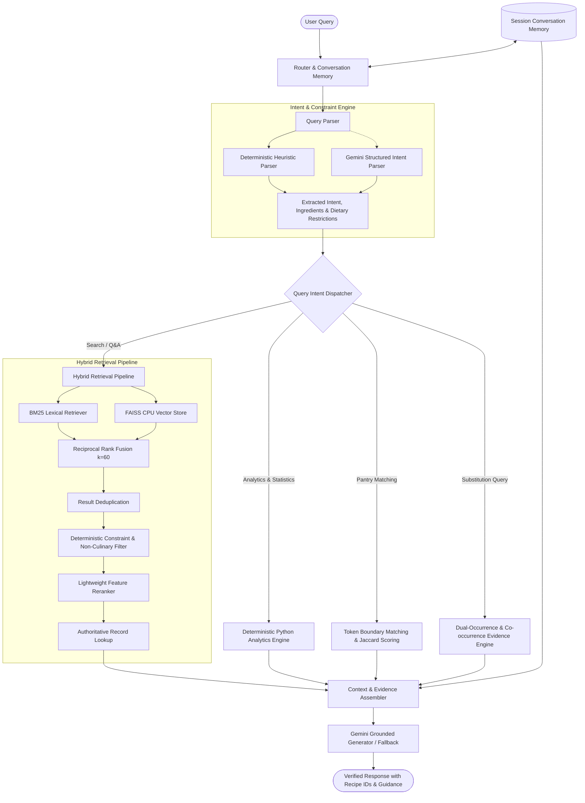

# 🍳 Nosh Recipe Assistant: Conversational Culinary Agent

[](https://www.python.org/)
[-brightgreen.svg)](tests/)
[](app/main.py)
[](docs/retrieval_pipeline.md)
[](app/dietary_filter.py)

A production-grade, interview-ready **Conversational Recipe Assistant** built on the **Eight Portions Recipe Dataset** (**122,938 usable recipes** from AllRecipes, Epicurious, and Food Network).

Engineered with a **truth-first hybrid retrieval architecture, deterministic cultural guardrails, and a sleek ChatGPT-style interface**:
- 🎨 **Minimalist ChatGPT Aesthetic**: Centered clean layout with instant **Light / Dark mode** toggle, `➕ New chat` session reset, 2x2 inspiration starter cards, and **zero developer diagnostic clutter** exposed to the user.
- 🔍 **Hybrid Retrieval Pipeline**: Combines **BM25 lexical scoring** with **FAISS dense vector embeddings** merged via **Reciprocal Rank Fusion (RRF $k=60$)**.
- 🇮🇳 **India-Aware Cultural Sensitivity**: Region defaults to India with automatic exclusion of beef from default discovery; respects explicit requests neutrally without demographic assumptions.
- 🥗 **Deterministic Multi-Dietary Filtering**: Strict Python query-time enforcement for **Vegetarian**, **Jain Vegetarian** (no root vegetables, onions, or garlic), **Vegan**, **No Beef**, **No Pork**, **No Seafood**, **No Eggs**, and custom user exclusions.
- 👩‍🍳 **Structured Step-by-Step Culinary Guides**: 13-point beginner-friendly cooking breakdowns with mise en place, required equipment, temperatures, sensory doneness tests, and Indian culinary terms (*Kheer, Payasam, Ghee, Elaichi, Chawal, Tadka*).
- 🔄 **Contextual Memory & Multi-Turn Refinement**: Preserves search context across turns (e.g., *"Find penne pasta recipes"* $\rightarrow$ *"I cannot have dairy"* refines prior results with ingredient evidence).
- 📊 **100% Reproducible Analytics**: Computes exact statistics (e.g. 20,244 recipes with garlic & onion = 16.47% of 122,938 total) purely in Python—*never hallucinated by an LLM*.

---

## ⚡ 5-Minute Setup & Quickstart Guide

Get the assistant up and running in **under 5 minutes**:

### 1. Clone the Repository
```bash
git clone https://github.com/Rudra-Nayak/RecipeChatbotAssistance.git
cd RecipeChatbotAssistance
```

### 2. Create and Activate Virtual Environment

**Windows (PowerShell):**
```powershell
python -m venv .venv
.\.venv\Scripts\Activate.ps1
```

**Windows (CMD):**
```cmd
python -m venv .venv
.\.venv\Scripts\activate.bat
```

**macOS / Linux:**
```bash
python3 -m venv .venv
source .venv/bin/activate
```

### 3. Install Dependencies
```bash
pip install -r requirements.txt
```

### 4. Initialize the Recipe Dataset
Run the one-line setup script to extract the bundled `recipes_raw.zip` and build the clean 122,938-recipe cache (`data/processed/recipes.pkl`):
```bash
python setup_dataset.py
```
> ⏱️ *Takes only ~15 seconds to parse, clean "ADVERTISEMENT" noise tokens, and save the binary cache.*

### 5. Configure API Key *(Optional)*
Copy the example environment template:
```bash
# Windows PowerShell:
Copy-Item .env.example .env

# macOS / Linux:
cp .env.example .env
```
Open `.env` and add your Google Gemini API key:
```env
GEMINI_API_KEY=your_actual_gemini_api_key_here
```
> 💡 **Graceful Offline Mode**: If no API key is provided, the chatbot automatically runs in **grounded template fallback mode** with full search, pantry matching, analytics, and substitutions working flawlessly.

### 6. Launch the Web Application
```bash
streamlit run app/main.py
```
Or use the launcher:
```bash
python run.py
```
👉 Open your browser at **`http://localhost:8501`**.

---

## 🧪 Running Automated Tests

The codebase includes **92 comprehensive unit tests** covering data loaders, BM25 retrieval, RRF ranking, dietary filters, pantry matching, substitutions, and analytics:

```bash
pytest tests/ -v
```
**Expected output:**
```text
============================= 92 passed in 15.33s =============================
```

To run the automated benchmark evaluation over multi-turn test scenarios:
```bash
python evaluation/run_evaluation.py
```

---

## 🏗️ Architecture & Retrieval Pipeline



---

## 🌟 Core Functional Capabilities & Tasks

### Task 1. Recipe Search & Discovery
- Cleans conversational prefixes (*"How do I make..."*, *"Can you guide me on..."*) to isolate core dish terms.
- Multi-turn refinement (e.g., *"Find a penne pasta recipe"* $\rightarrow$ *"I cannot have dairy"* refines prior results with ingredient evidence).
- Dish distinction awareness (e.g. Rice Kheer vs. Vermicelli Kheer vs. Rice Pudding).

### Task 2. Ingredient-Based Pantry Matching
- Matches pantry ingredients using **strict word-boundary tokens** (e.g. `butter` will never match `butterflies`, and `egg` will never match `eggplant`).
- Enforces hard constraints: max instruction steps (e.g., *"at most 6 steps"*), excluded allergens (*"no peanuts"*), and preferences (*"fewest additional ingredients"*).
- Follow-up dynamic exclusions (*"Exclude eggs too"* updates pantry results interactively).
- Reports transparent measurement caveats (*ingredient matches evaluated at name-level canonical normalization*).

### Task 3. Evidence-Based Ingredient Substitution
- Adapts recipes using local dataset evidence as the primary source of truth.
- Cites exact recipe IDs supporting substitutions (e.g., replacing eggs in banana bread with applesauce citing `.GLWQH0bkiU3fRzwc68PqTCqGHJj2fy` or mashed bananas citing `ij6QwLu2zgfChlFpoKA2KqoLRZiXb.6`).
- Provides updated ingredient lists, revised instructions, and culinary trade-offs on rise, crumb density, and moisture.

### Task 4. Deterministic Recipe Analytics
- Computes exact mathematical answers over the entire 122,938 recipe corpus.
- Example: *"How many recipes contain both garlic and onion? What percentage of the dataset is that?"*
  - **20,244 recipes** contain both garlic and onion.
  - **Dataset Denominator**: 122,938 total usable recipes.
  - **Percentage**: **16.47%**.
  - Detailed explanation of canonical name normalization.
- Ranks recipes by instruction steps or ingredient counts with stable recipe IDs.

---

## 📂 Project Directory Structure

```
NoshRecipeChatBot/
├── app/
│   ├── main.py                     # Streamlit ChatGPT-style web app (Light/Dark)
│   ├── router.py                   # Master query router & multi-turn dispatcher
│   ├── query_parser.py             # Heuristic + LLM intent & constraint parser
│   ├── recipe_search.py            # Hybrid search orchestration & filtering
│   ├── keyword_retrieval.py        # BM25 lexical retriever with stop-word pruning
│   ├── semantic_retrieval.py       # FAISS dense vector retriever
│   ├── hybrid_retrieval.py         # Reciprocal Rank Fusion (RRF k=60)
│   ├── reranker.py                 # Lightweight title & ingredient feature reranker
│   ├── dietary_filter.py           # India-aware, Jain, Vegan & allergen filters
│   ├── ingredient_match.py         # Word-boundary pantry matching & step scoring
│   ├── substitution.py             # Co-occurrence substitution evidence finder
│   ├── analytics.py                # Deterministic statistics & aggregations
│   ├── memory.py                   # Multi-turn conversation state manager
│   ├── llm.py                      # Gemini API grounded generator & templates
│   ├── recipe_loader.py            # Dataset loader, cleaner & validator
│   └── data_processor.py           # Text normalization & recipe validator
├── data/
│   └── processed/
│       └── recipes.pkl             # Generated 122,938 clean recipe cache (~176 MB)
├── recipes_raw.zip                 # Bundled raw dataset archive (50.8 MB)
├── tests/                          # 92 automated unit tests (pytest)
│   ├── test_data_loader.py
│   ├── test_retrieval.py
│   ├── test_analytics.py
│   ├── test_ingredient_match.py
│   ├── test_substitution.py
│   ├── test_memory.py
│   └── test_cultural_and_guidance.py
├── evaluation/
│   ├── evaluation_cases.json       # Benchmark test scenarios
│   ├── evaluation_results.json     # Benchmark latency & accuracy output
│   └── run_evaluation.py           # Evaluation runner script
├── docs/                           # In-depth architectural & design documentation
│   ├── architecture.md
│   ├── retrieval_pipeline.md
│   ├── data_dictionary.md
│   ├── testing_strategy.md
│   └── design_decisions.md
├── setup_dataset.py                # One-click dataset initialization script
├── run.py                          # Cross-platform application entrypoint
├── requirements.txt                # Python package dependencies
├── .env.example                    # Environment variable template
└── README.md                       # Interviewer setup guide & project overview
```

---

## 📊 Dataset Ingestion & Validation Summary

| Dataset Source | Raw Records | Usable Records | Dropped Records | Quality Issues Resolved |
|---|---|---|---|---|
| **AllRecipes (`ar`)** | 39,802 | 39,522 | 280 (0.7%) | Stripped 39,518 `"ADVERTISEMENT"` noise tokens |
| **Epicurious (`epi`)** | 25,323 | 25,261 | 62 (0.2%) | Cleaned empty ingredient lists and instruction strings |
| **Food Network (`fn`)** | 60,039 | 58,155 | 1,884 (3.1%) | Resolved 1,629 empty ingredient arrays & 289 null titles |
| **Total** | **125,164** | **122,938** | **2,226 (1.8%)** | **100% of 122,938 recipe IDs are globally unique** |

---

## 💬 Interview Technical Talking Points

1. **Why Hybrid Search (BM25 + FAISS)?**
   BM25 guarantees exact lexical matching for specific culinary ingredients (e.g., *"parmesan"*, *"basmati rice"*) where embeddings may blur distinct terms. FAISS provides semantic recall for broad concepts (e.g., *"light summer dinner"*).
2. **Why Reciprocal Rank Fusion (RRF)?**
   BM25 scores are unbounded $[0, \infty)$ while cosine similarity is $[-1, 1]$. RRF merges rankings score-agnostically ($k=60$) without requiring fragile score normalization.
3. **Why Deterministic Python Filters over LLM Prompting?**
   LLMs are prone to silent relaxation of dietary constraints (e.g. classifying oysters as vegetarian). Deterministic Python filtering against raw recipe strings guarantees 100% compliance with religious and allergen rules.
4. **How is Hallucination Eliminated?**
   Statistical queries are computed directly over the 122K dataset in Python. For cooking instructions and substitutions, the LLM is strictly grounded in retrieved recipe records and forbidden from inventing recipe IDs or ingredients.
5. **Windows Asynchronous Compatibility**:
   Configured with `asyncio.WindowsSelectorEventLoopPolicy()` to suppress `[WinError 10054]` WebSocket disconnect warnings during browser tab refreshes.

---

## 👤 Author
- **Rudra Nayak** — [GitHub](https://github.com/Rudra-Nayak)
