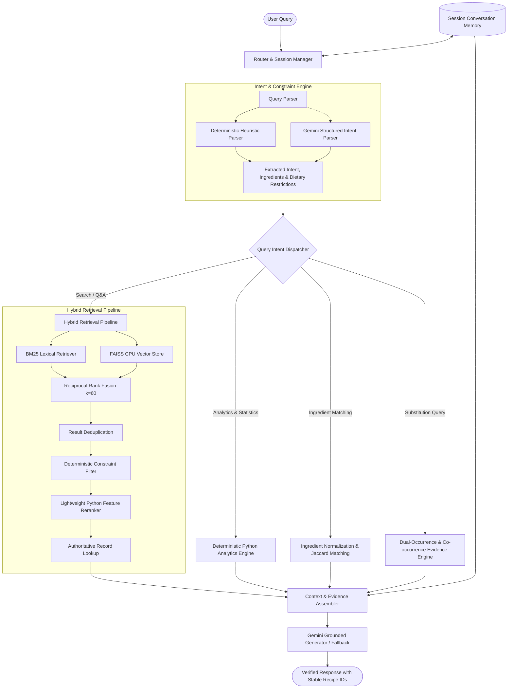

# 🍳 Nosh Recipe Assistant: Conversational Culinary Agent

[](https://www.python.org/)
[](tests/)
[](app/main.py)
[](docs/retrieval_pipeline.md)
[](app/dietary_filter.py)

A production-grade, interview-ready Conversational Recipe Assistant built on the **Eight Portions Recipe Dataset** (122,938 usable recipes from AllRecipes, Epicurious, and Food Network).

Engineered with a **truth-first hybrid retrieval architecture, cultural guardrails, and a modern ChatGPT-style interface**:
- **ChatGPT-Inspired Minimalist UI**: Sleek centered chat layout with instant Light/Dark mode switching, `+ New chat` reset button, 2x2 starter inspiration cards, and elimination of all irrelevant backend diagnostic clutter from user view.
- **BM25 lexical retrieval** + **FAISS dense vector search**
- **Reciprocal Rank Fusion (RRF)**
- **India-Aware Cultural Sensitivity**: Region defaults to India with automatic beef exclusion from default discovery; respects explicit beef requests neutrally without bias.
- **Deterministic Multi-Dietary Filtering**: Strict query-time enforcement for Vegetarian, Jain Vegetarian (no root produce/garlic/onion), Vegan, No Beef, No Pork, No Seafood, No Eggs, and custom exclusions.
- **Detailed Step-by-Step Cooking Guides**: 13-point structured beginner-friendly culinary guides with sensory/doneness cues, mise en place, equipment, common pitfalls, and Indian culinary terms (*Kheer, Payasam, Ghee, Elaichi, Chawal, Tadka*).
- **Contextual Intent Retention**: Recognizes ingredient omissions (*"I don't have coconut milk"*) while preserving culinary intent across turns.
- **Lightweight heuristic reranker** & **Grounded response generation** via Google Gemini API.

---

## 🌟 Key Functional Capabilities

1. **Recipe Search & Factual Q&A**: High-precision keyword & semantic search with stable 31-character recipe IDs.
2. **Deterministic Recipe Analytics**: Computes real-time statistics (totals, medians, most common ingredients, step rankings) directly over the 122K dataset—*never fabricated by the LLM*.
3. **Ingredient-Based Matching**: Matches recipes to ingredients in your pantry with Jaccard coverage scores, equivalent ingredient mappings, and clear missing-ingredient breakdowns.
4. **Evidence-Based Ingredient Substitution**: Locates co-occurrence and dual-usage evidence in the local dataset with confidence levels and culinary caveats.
5. **Session-Based Conversation Memory**: Maintains filters across turns (e.g., *"Find vegetarian potato recipes"* $\rightarrow$ *"Which one has the fewest steps?"* operates on the prior result set).

---

## 🏗️ System Architecture



---

## 📂 Project Directory Structure

```
NoshRecipeChatBot/
├── data/
│   ├── raw/                        # Placeholder for raw inputs
│   └── processed/
│       └── recipes.pkl             # Serialized 122,938 validated recipes
├── recipes_raw/                    # Eight Portions dataset (ar, epi, fn)
│   ├── recipes_raw_nosource_ar.json
│   ├── recipes_raw_nosource_epi.json
│   └── recipes_raw_nosource_fn.json
├── app/
│   ├── __init__.py
│   ├── main.py                     # Streamlit web application
│   ├── recipe_loader.py            # Data loading, cleaning & validation
│   ├── data_processor.py           # Text representation & normalization
│   ├── query_parser.py             # Intent & constraint extraction
│   ├── router.py                   # Master request dispatcher
│   ├── keyword_retrieval.py        # Rank-BM25 retriever
│   ├── semantic_retrieval.py       # FAISS vector similarity retriever
│   ├── hybrid_retrieval.py         # Reciprocal Rank Fusion (RRF)
│   ├── reranker.py                 # Lightweight feature reranker
│   ├── recipe_search.py            # Search orchestration & constraint filters
│   ├── analytics.py                # Deterministic statistics computations
│   ├── ingredient_match.py         # Ingredient overlap matching
│   ├── substitution.py             # Evidence-based substitution finder
│   ├── memory.py                   # Session state management
│   ├── llm.py                      # Gemini API integration & template fallback
│   └── build_index.py              # FAISS index generator script
├── vector_store/                   # Local FAISS index & metadata
├── tests/                          # 80 automated unit tests
│   ├── test_data_loader.py
│   ├── test_retrieval.py
│   ├── test_analytics.py
│   ├── test_ingredient_match.py
│   ├── test_substitution.py
│   └── test_memory.py
├── evaluation/
│   ├── evaluation_cases.json       # 7 benchmark test scenarios
│   ├── evaluation_results.json     # Measured latency & evaluation output
│   ├── failure_analysis.md         # Failure mode documentation
│   └── run_evaluation.py           # Evaluation runner script
├── docs/                           # Complete technical documentation suite
│   ├── architecture.md
│   ├── user_flow.md
│   ├── data_dictionary.md
│   ├── retrieval_pipeline.md
│   ├── api_design.md
│   ├── testing_strategy.md
│   ├── evaluation_report.md
│   ├── design_decisions.md
│   └── limitations.md
├── .env.example
├── .gitignore
├── requirements.txt
├── README.md
└── run.py                          # Launcher entrypoint
```

---

## ⚡ Quickstart & Setup Guide

### 1. Prerequisites
- Python 3.11, 3.12, or 3.13 installed.
- Git.

### 2. Environment Setup

#### Create Virtual Environment:
```powershell
python -m venv .venv
```

#### Activate on Windows PowerShell:
```powershell
.\.venv\Scripts\Activate.ps1
```

#### Activate on Windows Command Prompt (CMD):
```cmd
.venv\Scripts\activate.bat
```

#### Install Dependencies:
```powershell
pip install -r requirements.txt
```

### 3. Configure API Key
Create a `.env` file from the example template:
```powershell
Copy-Item .env.example .env
```
Edit `.env` and add your Google Gemini API key:
```env
GEMINI_API_KEY=your_actual_gemini_api_key_here
```
*(Note: If no API key is provided, the chatbot seamlessly operates in deterministic template fallback mode with zero crashes).*

---

## 🚀 Running the Application

### Start the Streamlit Web Chatbot:
```powershell
streamlit run app/main.py
```
Or use the launcher:
```powershell
python run.py
```
Open your browser at `http://localhost:8501`.

---

## 🧪 Testing & Verification

### Run the Full Unit Test Suite (80 Tests):
```powershell
.\.venv\Scripts\pytest.exe tests/ -v
```
*Current test status: 80 passed in ~26 seconds.*

### Run Automated Evaluation Benchmark:
```powershell
.\.venv\Scripts\python.exe evaluation/run_evaluation.py
```
Executes all 7 multi-turn scenarios, evaluates latency across 122K records, and writes `evaluation/evaluation_results.json`.

---

## 📊 Dataset Ingestion & Validation Summary

| Dataset Source | Raw Records | Usable Records | Dropped Records | Quality Issues Resolved |
|---|---|---|---|---|
| **AllRecipes (`ar`)** | 39,802 | 39,522 | 280 (0.7%) | Removed 39,518 `"ADVERTISEMENT"` noise tokens |
| **Epicurious (`epi`)** | 25,323 | 25,261 | 62 (0.2%) | Cleaned empty ingredient lists and instruction strings |
| **Food Network (`fn`)** | 60,039 | 58,155 | 1,884 (3.1%) | Resolved 1,629 empty ingredient arrays & 289 null titles |
| **Total** | **125,164** | **122,938** | **2,226 (1.8%)** | **100% of 122,938 recipe IDs are globally unique** |

---

## 💬 Live Interview Talking Points

1. **Why Hybrid Search (BM25 + FAISS)?**
   *BM25 guarantees exact keyword matching for culinary terms (e.g. "parmesan", "risotto") where dense embeddings might blur specific dish names. FAISS enables conceptual searches (e.g. "cozy winter meal").*
2. **Why Reciprocal Rank Fusion (RRF)?**
   *BM25 scores are unbounded $[0, \infty)$ while cosine similarity is $[-1, 1]$. RRF merges rankings score-agnostically ($k=60$) without requiring unstable score calibration.*
3. **Why Hard Constraints in Python?**
   *Dense embeddings cannot guarantee negation. An embedding search for "vegetarian lasagna" often surfaces meat lasagna. We filter deterministically against the raw ingredient list before final ranking.*
4. **Why Lightweight Heuristic Reranker?**
   *Cross-encoder BERT models add 300–600ms latency on CPU. A transparent feature scorer (Title match + Ingredient coverage + Instruction overlap) executes in $<2$ms and is completely explainable.*
5. **How is Hallucination Prevented?**
   *Statistical queries are computed over the full dataset in Python. For search, the LLM receives strictly retrieved recipe records and is prompted never to fabricate recipe IDs or ingredients.*

