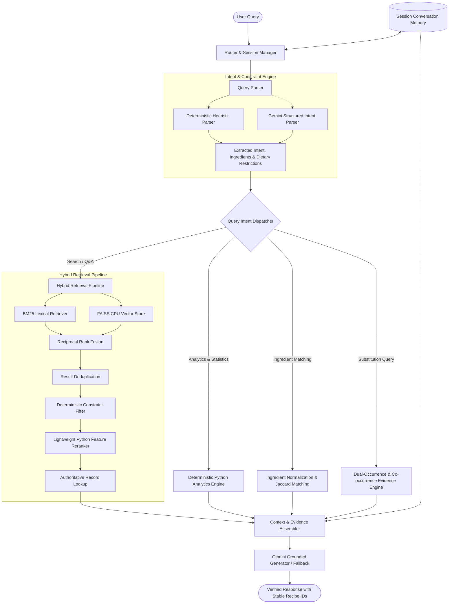

# Architecture Document: Nosh Conversational Recipe Assistant

## 1. Project Overview
The Nosh Recipe Chatbot is an enterprise-grade, interview-ready conversational recipe assistant engineered specifically for home-robotics and culinary guidance scenarios. It bridges large-scale unstructured culinary knowledge (122,938 curated recipes across AllRecipes, Epicurious, and Food Network) with deterministic algorithmic guarantees and grounded generative AI.

The core design principle is **truthfulness through deterministic pipelines**:
- High-recall hybrid retrieval (BM25 keyword search + FAISS vector search).
- Rank fusion via Reciprocal Rank Fusion (RRF).
- Hard constraint filtering in pure Python against authoritative recipe records (never trusting raw similarity scores as constraint proof).
- Lightweight Python reranking.
- Grounded generation via Google Gemini API strictly constrained to retrieved context with stable Recipe IDs.

---

## 2. High-Level Architecture & Component Responsibilities

---

## 3. Component Details

### 3.1 Data Ingestion & Caching Layer (`app/recipe_loader.py`)
- Reads 3 distinct JSON datasets from `recipes_raw/`:
  - `recipes_raw_nosource_ar.json` (AllRecipes: 39,802 records)
  - `recipes_raw_nosource_epi.json` (Epicurious: 25,323 records)
  - `recipes_raw_nosource_fn.json` (Food Network: 60,039 records)
- Filters invalid records (missing title, empty ingredients, or empty instructions).
- Cleans data-quality defects (e.g., stripping 39,518 instances of `"ADVERTISEMENT"` artifacts from AllRecipes).
- Serializes 122,938 validated recipes into binary pickle format (`data/processed/recipes.pkl`) ensuring instantaneous application startup (<1.2s vs >15s JSON parsing).

### 3.2 Query Parsing & Understanding (`app/query_parser.py`)
- Extracts intent: `search`, `analytics`, `ingredient_match`, `substitution`, `followup`, `general`.
- Extracts entities: target ingredients, quantities (where parseable), and dietary exclusions (`vegetarian`, `vegan`, `gluten-free`, `dairy-free`, `nut-free`).
- Implements two-tier processing: fast local regex heuristics fallback alongside Gemini structured JSON extraction.

### 3.3 Hybrid Retrieval Engine (`app/hybrid_retrieval.py`, `app/keyword_retrieval.py`, `app/semantic_retrieval.py`)
- **Lexical BM25 (Rank-BM25)**: Evaluates term-frequency and inverse-document-frequency across composite title + ingredient + instruction text.
- **Dense FAISS (IndexFlatIP)**: Generates 768-dimensional normalized embeddings (`text-embedding-004`) for semantic matching, persisted to disk.
- **Reciprocal Rank Fusion (RRF)**: Merges disparate score scales using $RRF(d) = \sum_{m \in M} \frac{1}{60 + r_m(d)}$.

### 3.4 Hard Constraint Verification (`app/recipe_search.py`)
- Vector embeddings and BM25 scores do not guarantee constraint adherence (e.g., semantic search for "vegetarian lasagna" often surfaces meat lasagnas with high similarity).
- Candidate recipes are verified against authoritative raw ingredients using deterministic exclusion sets before passing to downstream stages.

### 3.5 Deterministic Analytics (`app/analytics.py`)
- Evaluates statistical questions directly over the full dataset ($N=122,938$) or active conversation filters.
- Eliminates numerical hallucination by computing exact counts, medians, averages, and step rankings in pure Python.

### 3.6 Session Memory (`app/memory.py`)
- Maintains multi-turn context (active filters, previous matched recipe IDs, dietary preferences) within `st.session_state`.
- Enables contextual follow-ups like *"Which one has the fewest steps?"* to resolve strictly over previously retrieved candidates.

### 3.7 LLM Grounding & Fallback (`app/llm.py`)
- Uses Google Gemini API (`gemini-2.0-flash`).
- Prompts enforce strict attribution: the model is explicitly forbidden from referencing items outside the provided retrieval envelope.
- Provides a clean template-based fallback when offline or without an API key.

---

## 4. Scalability & Architectural Trade-Offs

| Decision | Chosen Approach | Alternative Considered | Why Chosen |
|---|---|---|---|
| **Vector DB** | FAISS CPU (Flat Inner Product) | Pinecone / Qdrant / Milvus | Zero infrastructure overhead, zero network round-trip latency, runs locally on developer machine. |
| **Rank Fusion** | Reciprocal Rank Fusion ($k=60$) | Linear Score Combination | BM25 (unbounded positive) and Cosine Similarity ($[-1, 1]$) have incompatible scales; RRF is score-agnostic. |
| **Reranking** | Lightweight Python Feature Reranker | Cross-Encoder BERT (`ms-marco-MiniLM`) | Cross-encoders introduce 300–600ms latency per query on CPU; heuristic feature reranker executes in <2ms. |
| **Memory** | In-Memory Session Dataclass | Redis / LangChain ConversationBuffer | Simple, auditable, no external process requirements, perfectly suited for Streamlit sessions. |

