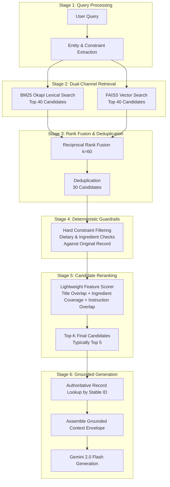

# Retrieval Pipeline & Ranking Methodology

## 1. Overview
The retrieval pipeline is engineered to deliver high precision, high recall, low latency, and zero semantic drift under strict dietary constraints.

---

## 2. Pipeline Components & Mathematical Formulation

### 2.1 BM25 Lexical Retrieval
BM25 captures exact token matches (e.g., proper dish names, specific spices). Given query $Q$ with terms $q_1, \dots, q_n$ and document $D$:
$$\text{BM25}(D, Q) = \sum_{i=1}^n \text{IDF}(q_i) \cdot \frac{f(q_i, D) \cdot (k_1 + 1)}{f(q_i, D) + k_1 \cdot \left(1 - b + b \cdot \frac{|D|}{\text{avgdl}}\right)}$$
Parameters: $k_1 = 1.5$, $b = 0.75$.

### 2.2 Semantic Vector Retrieval (FAISS)
Semantic search maps conversational queries (e.g., *"light dinner with summer vegetables"*) to conceptual embeddings using Google's `text-embedding-004`. Vectors are $L_2$-normalized such that inner product equals cosine similarity:
$$\text{sim}(u, v) = \frac{u \cdot v}{\|u\|_2 \|v\|_2} = \langle \hat{u}, \hat{v} \rangle$$
Indexed via `faiss.IndexFlatIP` (dim = 768) on CPU.

### 2.3 Reciprocal Rank Fusion (RRF)
BM25 produces unbounded positive scores; vector search produces cosine similarities $[-1, 1]$. Direct score interpolation requires fragile calibration. RRF combines rankings independently of score scale:
$$\text{RRF\_Score}(d \in D) = \sum_{m \in M} \frac{1}{k + r_m(d)}$$
Where $M = \{\text{BM25}, \text{FAISS}\}$, $k = 60$, and $r_m(d)$ is the 1-based rank of document $d$ in system $m$.

### 2.4 Deterministic Hard Constraint Filtering
**Cardinal Rule**: *Vector similarity is never proof of constraint satisfaction.*
If a user requests a "vegetarian" or "gluten-free" recipe, candidates with high semantic similarity to meat or gluten dishes must be filtered out deterministically.
- `app/recipe_search.py: filter_by_dietary` inspects the raw, authoritative ingredient list of each candidate against strict exclusion sets.
- Candidates violating any constraint are dropped before reranking.

### 2.5 Lightweight Feature-Based Reranker
After filtering, candidate documents are scored using a linear combination of explainable features:
$$\text{Score}(Q, R) = 3.0 \cdot \text{Coverage}_{\text{title}} + 2.0 \cdot \text{Bonus}_{\text{exact}} + 2.0 \cdot \text{Coverage}_{\text{ingredients}} + 0.5 \cdot \text{Overlap}_{\text{instructions}} + \text{Bonus}_{\text{quality}} + 10.0 \cdot \text{RRF}$$
This lightweight reranker operates in $<2$ milliseconds per candidate set on CPU, bypassing the 300–600ms latency and heavy PyTorch dependencies of transformer cross-encoders.

