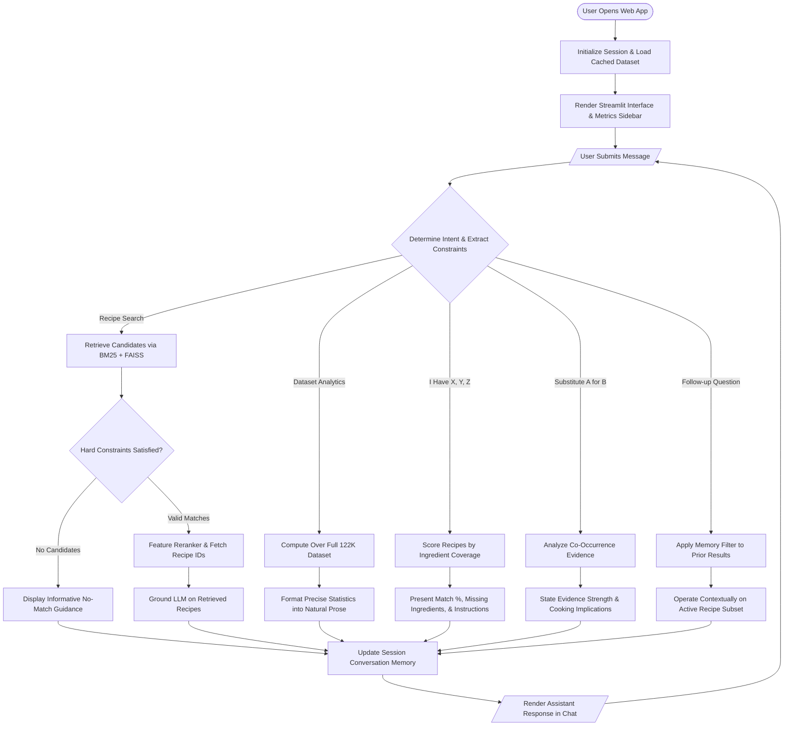
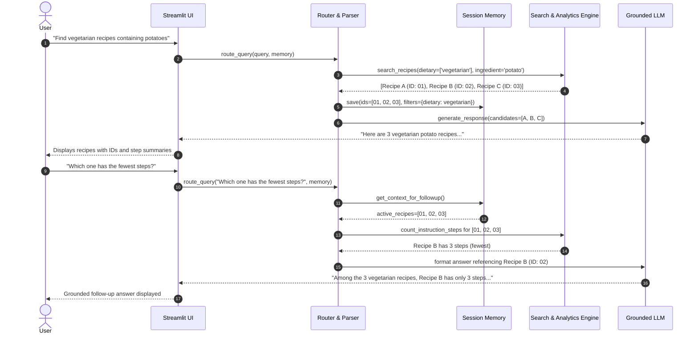

# User Flow & Interaction Specification

## 1. Overview of Interaction Flows
The Nosh Recipe Assistant supports 7 distinct interaction pathways:
1. **First-Time User Initialization Flow**
2. **Recipe Search & Factual Q&A Flow**
3. **Statistical Analytics Flow**
4. **Ingredient-Based Matching Flow**
5. **Evidence-Based Substitution Flow**
6. **Multi-Turn Context & Follow-Up Flow**
7. **No-Match & Graceful Recovery Flow**

---

## 2. Interaction Flowcharts

### 2.1 Complete Conversational Lifecycle

---

### 2.2 Multi-Turn Context Follow-Up Flow

---

## 3. Failure & Edge Case Handling

### 3.1 Zero-Match Scenarios
When a query produces no results (e.g. impossible ingredient combination or contradictory constraints):
- **Never fabricate** synthetic recipes.
- Clarify the active constraint that caused zero matches (e.g., *"No recipes found combining salmon with vegan constraint"*).
- Suggest actionable relaxation paths (e.g., broaden ingredient keywords or remove dietary filters).

### 3.2 Gemini API Unavailability / Rate Limits
If the external Gemini API is unreachable or fails:
- System transitions to **Deterministic Template Fallback** (`app/llm.py: _fallback_response`).
- Exact recipe IDs, ingredient lists, instructions, and statistical results are rendered via deterministic Markdown formatting without degradation of functional correctness.

